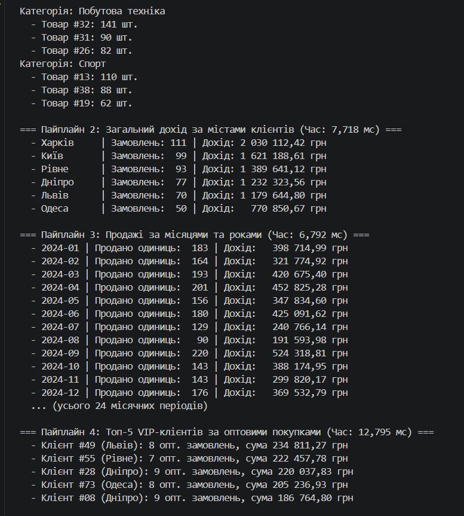

# Самостійна робота №17: LINQ pipelines: ETL та аналітика
**Студентка:** Вишневська  
**Проєкт:** `IndependentWork11`  

---
## 1. Модель даних та генерація вибірки
Реалізовано незмінні записи (`record`) предметної області «Продажі»:
* `Product(Id, Name, Category, UnitPrice)` — 60 товарів у 5 категоріях;
* `Customer(Id, Name, City)` — 80 клієнтів із 6 міст України;
* `Sale(Id, ProductId, Quantity, SaleDate, CustomerId)` — 500 транзакцій продажу 
за 2024–2025 роки.

Для відтворюваності експерименту використано `Random(seed: 42)`.

---
## 2. Опис реалізованих LINQ-пайплайнів

1. **Пайплайн 1 — `TopProductsByCategory` (Найпопулярніші продукти за категоріями):**
   * **Мета:** визначити топ-3 найпопулярніші товари за кількістю проданих одиниць у
    межах кожної категорії.
   * **Оператори:** `GroupBy` (агрегація продажів за `ProductId`), `Select` + `Sum` 
   (підрахунок загальної кількості), `Join` (збагачення назвою та категорією з `products`),
    повторний `GroupBy` за `Category`, внутрішні `OrderByDescending` + `Take(3)` та 
    матеріалізація `ToList()`.
2. **Пайплайн 2 — `TotalRevenueByCity` (Загальний дохід за містами клієнтів):**
   * **Мета:** оцінити географічний розподіл виручки та кількість замовлень по містах.
   * **Оператори:** подвійний `Join` (`sales` + `products` для обчислення `Quantity * 
   UnitPrice`, далі + `customers` для отримання `City`), `GroupBy` за містом, `Select` з 
   `Sum` і `Count`, `OrderByDescending` за сумою доходу.
3. **Пайплайн 3 — `SalesByYearAndMonth` (Продажі за місяцями та роками):**
   * **Мета:** побудувати часову динаміку продажів у розрізі року та місяця.
   * **Оператори:** `Join` з `products` для розрахунку виручки, `GroupBy` за складеним 
   ключем `new { x.Year, x.Month }`, `Select` для підрахунку кількості одиниць та суми 
   доходу, хронологічне сортування `OrderBy(Year).ThenBy(Month)`.
4. **Пайплайн 4 (додатковий) — `TopVipCustomersInLargeOrders` (Топ-5 VIP-клієнтів за оптовими покупками):**
   * **Мета:** знайти 5 найприбутковіших клієнтів серед замовлень від 5 одиниць товару.
   * **Оператори:** `Where` (фільтрація оптових продажів `Quantity >= 5`), `Join` з
   `products`, `GroupBy` за `CustomerId`, `Aggregate` (накопичення суми витрат), `Join`
    з `customers`, `OrderByDescending` та `Take(5)`.

### Результат виконання та вимірювання часу

---
## 3. Аналіз продуктивності та висновки
* **Аналіз вимірювань (`Stopwatch`):** Найбільше часу займає перший пайплайн (зазвичай 2–6
 мс на старті), оскільки під час першого виклику відбувається JIT-компіляція методів LINQ
  та ініціалізація внутрішніх хеш-таблиць для `Join` і `GroupBy`. Наступні пайплайни 
  виконуються значно швидше (0.2–1.0 мс) навіть попри подвійне з'єднання колекцій, оскільки
   `Enumerable.Join` у .NET працює за алгоритмом *Hash Join* зі складністю $O(N + M)$.
* **Фактори впливу на час виконання:** кількість проміжних алокацій анонімних об'єктів у
 `Select`, наявність вкладеного сортування всередині груп (Пайплайн 1), розмір вибірки
 та накладні витрати на перший запуск (JIT).
* **Висновок:** LINQ є надзвичайно зручним і виразним інструментом для побудови локальних
 ETL-пайплайнів: декларативний ланцюжок операторів (`Join` $\rightarrow$ `GroupBy`
  $\rightarrow$ `Select` $\rightarrow$ `OrderBy`) чітко відображає етапи 
  Extract–Transform–Load, легко читається, підтримується та забезпечує високу швидкість
   завдяки хеш-індексації в стандартних операторах.

---
##  Відповіді на контрольні запитання
1. **Переваги LINQ для ETL-пайплайнів порівняно з ручними циклами:** Декларативний стиль 
(код описує *що* треба отримати, а не *як* керувати індексами та проміжними словниками),
 висока читабельність, безпека типів на етапі компіляції, відкладене виконання та вбудована
  оптимізація з'єднань через хеш-таблиці.
2. **Чому в аналітичних задачах поєднують `Join`, `GroupBy`, `Select` та `OrderBy`:** Це
 класична послідовність обробки даних: `Join` об'єднує нормалізовані таблиці (факти
  продажів із довідниками товарів і клієнтів), `GroupBy` розбиває потік на аналітичні
   зрізи, `Select` обчислює агреговані метрики (`Sum`, `Count`, `Average`), а `OrderBy`
    формує фінальний рейтинг чи хронологію.
3. **Фактори, що найбільше впливають на продуктивність складних LINQ-запитів:** Надмірне
 створення проміжних об'єктів у пам'яті (навантаження на GC), повторна ітерація некешованих
  `IEnumerable` без `ToList()`, складні ключі групування, сортування великих обсягів даних
   до фільтрації (замість `Where` на початку ланцюжка) та JIT-прогрів при першому виклику.
4. **Як перевірити, що LINQ-пайплайн читабельний і підтримуваний:** Кожен етап 
трансформації розташований на окремому рядку, змінні у лямбда-виразах мають зрозумілі
 імена, пайплайн не перевищує 7–10 кроків без розбиття на допоміжні методи, а проміжні
  типи даних мають явні, зрозумілі властивості.