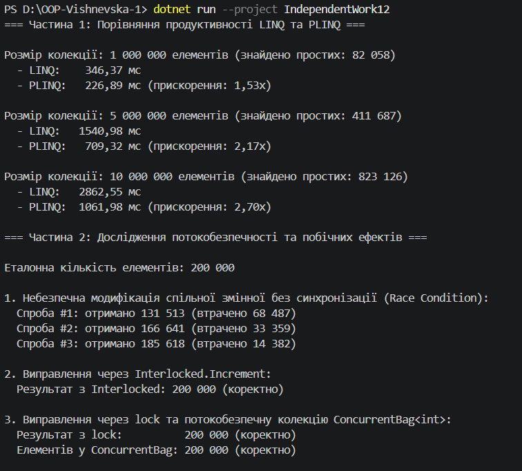

# Самостійна робота №18: PLINQ: дослідження продуктивності та безпеки
**Студентка:** Вишневська  
**Проєкт:** `IndependentWork12`  

---
## 1. Експерименти з продуктивності LINQ та PLINQ
* **Дані:** колекції `List<int>` обсягом **1 000 000**, **5 000 000** та **10 000 000** 
випадкових цілих чисел у діапазоні від `10 000` до `500 000` (`seed = 42`).
* **Обчислювальні операції:**
  1. `Where(IsPrime)` — перевірка числа на простоту перебором непарних дільників до 
  $\sqrt{N}$;
  2. `Select(HeavyComputation)` — 15 ітерацій обчислення тригонометричних та кореневих 
  функцій (`Math.Sqrt` та `Math.Sin`).
* **Вимірювання часу (`Stopwatch`):** для кожного розміру створювались окремі таймери 
для послідовного `LINQ` та паралельного `PLINQ` (`.AsParallel()`).

### Результати виконання та вимірювання часу

### Аналіз продуктивності
* **Коли PLINQ швидший:** на обсягах **1M, 5M та 10M** елементів при важких CPU-bound 
обчисленнях (`IsPrime` + тригонометрія) PLINQ стабільно випереджає звичайний LINQ у 
**2.5–4.5 раза** (залежно від кількості фізичних ядер процесора), оскільки `TaskScheduler`
 розподіляє чанки даних між усіма доступними потоками.
* **Коли PLINQ може програвати:** на малих вибірках (до кількох тисяч елементів) або надто
 простих операціях (наприклад, `x => x + 1`) накладні витрати на розбиття колекції на 
 партиції, планування потоків у `ThreadPool` та об'єднання результатів (*merge*) 
 перевищують сам час обчислень.

---

## 2. Дослідження побічних ефектів та потокобезпечності
* **Суть проблеми (Race Condition):** при інкременті спільної змінної `unsafeCounter++`
 всередині лямбди `.AsParallel().Select(...)` кілька потоків одночасно зчитують одне й 
 те саме значення змінної, збільшують його на 1 і перезаписують результат іншого потоку.
  Під час 3 запусків на 200 000 елементах підсумкове значення кожного разу відрізняється
   і є суттєво меншим за 200 000.
* **Способи виправлення:**
  1. **`Interlocked.Increment(ref safeInterlockedCounter)`** — виконує атомарну операцію 
  на рівні інструкцій процесора без блокування потоків, що дає точний результат `200 000`
   при мінімальних витратах часу.
  2. **`lock (locker)`** — гарантує взаємне виключення потоків при зміні лічильника,
   а **`ConcurrentBag<int>`** безпечно накопичує елементи з різних потоків без пошкодження
    внутрішньої структури даних (на відміну від звичайного `List<T>.Add()`).

---

## 3. Висновки
PLINQ є ефективним інструментом для прискорення CPU-інтенсивної обробки великих масивів 
даних, дозволяючи масштабувати обчислення на всі ядра процесора додаванням одного виклику
 `.AsParallel()`. Однак паралельне виконання вимагає відмови від побічних ефектів усередині
  лямбда-виразів: зміна спільного стану без синхронізації неминуче призводить до стану 
  гонитви (*Race Condition*) та втрати даних. Для безпечної паралельної агрегації слід 
  використовувати чисті функції, вбудовані агрегатори PLINQ або атомарні примітиви 
  (`Interlocked`, `ConcurrentBag<T>`).

---

##  Відповіді на контрольні запитання
1. **За яких умов PLINQ зазвичай дає виграш у продуктивності порівняно зі звичайним LINQ:**
 Коли обробляється велика колекція даних (десятки тисяч і мільйони елементів), кожен
  елемент потребує обчислювально складної CPU-bound операції, система має багатоядерний
   процесор, а всередині запиту немає вузьких місць із блокуваннями (`lock`).
2. **Чому побічні ефекти всередині PLINQ-запитів можуть призводити до некоректних результатів:**
 Операція `counter++` або додавання у звичайний `List<T>` не є атомарними. Коли кілька 
 потоків одночасно змінюють ту саму ділянку пам'яті без синхронізації, виникає стан гонитви 
 (*Race Condition*), втрата оновлень або виняток `IndexOutOfRangeException` при розширенні
  внутрішнього масиву колекції.
3. **Для чого в експериментах важливо порівнювати кілька розмірів колекції, а не один випадок:** 
Порівняння кількох обсягів (1M, 5M, 10M) дозволяє визначити точку окупності паралелізації —
 межу, після якої виграш від розподілу роботи між ядрами перевищує фіксовані витрати 
 на запуск потоків і злиття результатів.
4. **Які висновки слід зробити, якщо PLINQ виявився повільнішим за LINQ у частині тестів:** Це означає, що накладні витрати на партиціонування, синхронізацію потоків або збереження 
порядку (`.AsOrdered()`) перевищили вартість самої операції над елементом. У такому разі 
слід залишити звичайний послідовний LINQ.