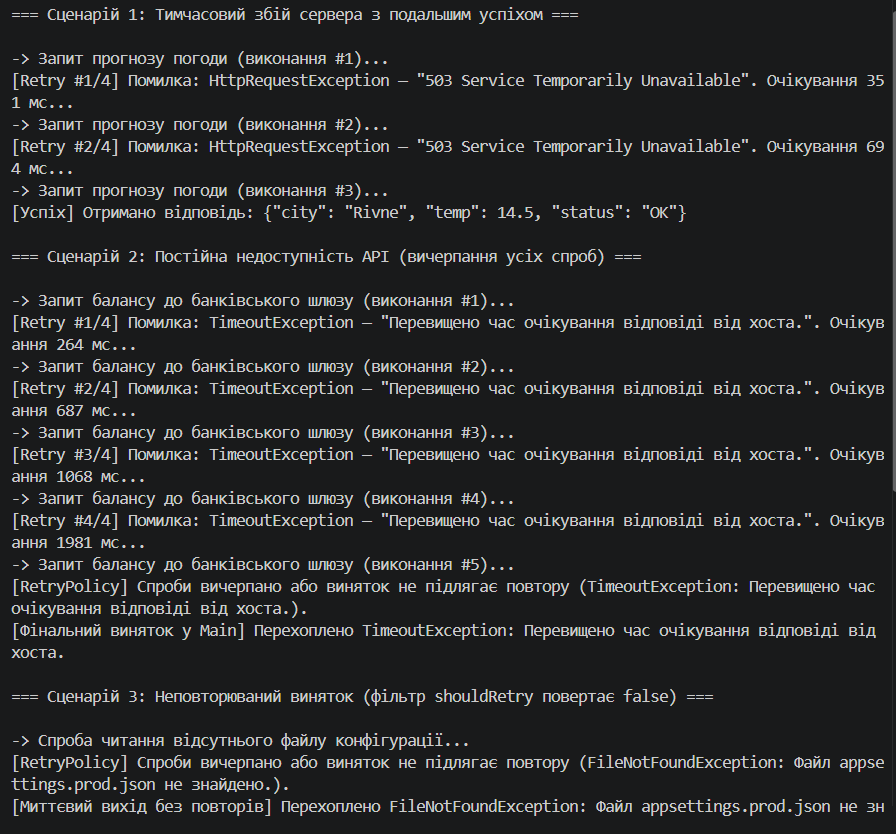

# Самостійна робота №20: Реалізація exponential backoff
**Студентка:** Вишневська  
**Проєкт:** `IndependentWork14`  

---
## 1. Реалізація класу `RetryPolicy`
Розроблено узагальнений клас `RetryPolicy`, який приймає максимальну кількість повторних
 спроб (`_maxRetries = 4`), початкову затримку (`_initialDelay = 300 мс`) та коефіцієнт 
 випадкового розкиду (`_jitterFactor = 0.25`).
У методі `Execute<T>(Func<T> operation, Func<Exception, bool>? shouldRetry = null)` 
реалізовано обчислення затримки за формулою експоненційного зростання з двостороннім jitter 
($\pm 25\%$):
$$\text{delay} = \text{initialDelay} \times 2^{\text{retryAttempt}} \times \left(1 + \text
{random.NextDouble()} \times \text{jitterFactor} \times 2 - \text{jitterFactor}\right)$$

---
## 2. Демонстрація сценаріїв у `Main`
1. **Тимчасовий збій з подальшим успіхом:** перші два звернення до сервісу прогнозу погодизавершуються `HttpRequestException (503)`, після чого виконуються затримки ~300 м
 та ~600 мс (з урахуванням jitter), а третій виклик повертає коректний JSON.
2. **Постійна недоступність API:** усі 5 викликів (1 початковий + 4 повторні спроби) 
завершуються `TimeoutException`. Затримки експоненційно зростають (~300 мс $\rightarrow$ 
~600 мс $\rightarrow$ ~1200 мс $\rightarrow$ ~2400 мс), після чого політика прокидає 
виняток у `Main`.
3. **Фільтрація через `shouldRetry`:** при виникненні `FileNotFoundException` делегат 
`shouldRetry` повертає `false`, тому повторні спроби не виконуються, і виняток миттєво 
передається викликаючому коду.

### Результат виконання програми

---
## 3. Висновки щодо меж застосування патерну Retry з exponential backoff
Патерн **Retry з exponential backoff та jitter** є ефективним засобом підвищення 
відмовостійкості при короткочасних інфраструктурних збоях: мережевих втратах пакетів,
 тимчасовому перевантаженні зовнішніх API (`429 Too Many Requests`, `503 Service 
 Unavailable`) або блокуваннях у базі даних. Експоненційне збільшення паузи дає 
 перевантаженому серверу час на відновлення, а випадковий *jitter* розсинхронізує потоки 
 клієнтів.

Водночас патерн має чіткі межі застосування:
* **Не підходить для постійних помилок:** помилки бізнес-логіки, неправильні облікові дані 
(`401`/`403`), відсутні ресурси (`404`, `FileNotFoundException`) або помилки валідації не 
зникнуть після повторної спроби — їх потрібно відсікати через `shouldRetry`.
* **Небезпечний для неідемпотентних операцій:** повторне виконання платіжної транзакції чи
 створення замовлення без ключа ідемпотентності може призвести до дублювання операцій, якщо
  перший запит встиг виконатися, але відповідь загубилася через тайм-аут.
* **Тривалі збої:** якщо зовнішній сервіс впав надовго, багаторазові ретраї лише затримують 
відповідь користувачеві — у таких випадках `Retry` слід поєднувати з патернами `Timeout`
 та `Circuit Breaker`.

---
##  Відповіді на контрольні запитання
1. **Чому експоненційна затримка ефективніша за фіксовану для тимчасових збоїв:** Фіксована 
затримка продовжує навантажувати проблемний сервіс із постійною частотою, не даючи йому
 розвантажити чергу. Експоненційна затримка швидко збільшує інтервали між спробами,
  знижуючи тиск на інфраструктуру та підвищуючи шанси дочекатися відновлення сервісу.
2. **Для чого потрібен jitter і як він зменшує ризик одночасних повторних спроб:** Якщо
 тисячі клієнтів отримали збій в одну секунду, без випадкового зміщення вони всі одночасно 
 повторять запит через 1 с, 2 с, 4 с, створюючи хвилі пікового навантаження (*thundering 
 herd*). Jitter додає випадковий розкид до часу очікування, рівномірно розподіляючи запити 
 в часі.
3. **Яку роль відіграє делегат `shouldRetry` у власній реалізації політики повторних 
спроб:** Він відділяє тимчасові (транзитні) винятки, які варто повторювати 
(`HttpRequestException`, `TimeoutException`), від фатальних або логічних помилок 
(`ArgumentException`, `FileNotFoundException`, помилки авторизації), для яких повтори не 
мають сенсу.
4. **У яких випадках повторна спроба не є безпечною та її слід заборонити:** Коли операція
 не є ідемпотентною (наприклад, списання коштів з картки, нарахування бонусів, відправка
  електронного листа або створення нового запису без перевірки дублікатів), оскільки 
  повторний виклик після мережевого таймауту може виконати дію двічі.s