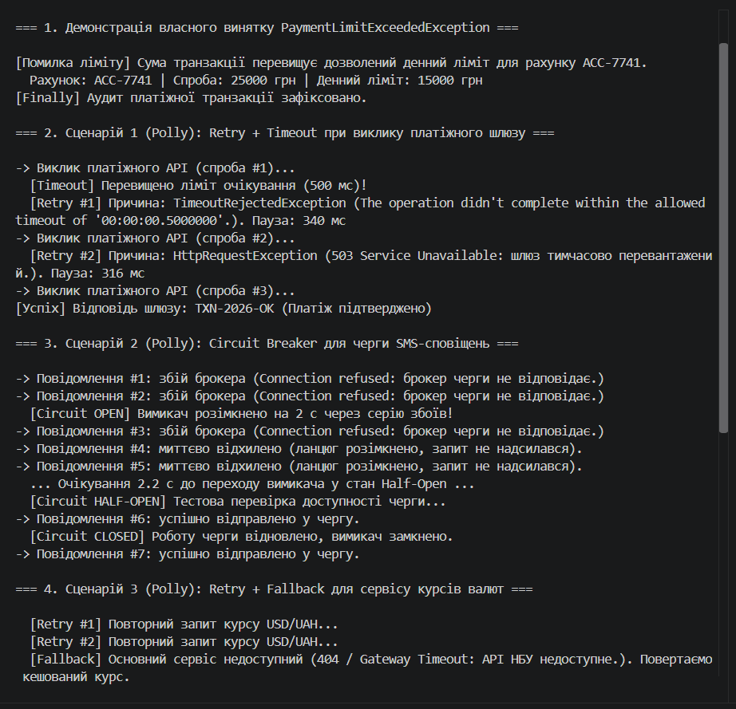

# Самостійна робота №19: Дизайн винятків і політики retry: теорія та кейси Polly
**Студентка:** Вишневська  
**Проєкт:** `IndependentWork19`  

---
## 1. Власний тип винятку `PaymentLimitExceededException`
У предметній області платіжних операцій створено спеціалізований виняток 
`PaymentLimitExceededException : Exception`, який містить три стандартні конструктори
 (`()`, `(string message)`, `(string message, Exception innerException)`), розширений 
 конструктор та контекстні властивості: `AccountId`, `AttemptedAmount` і `DailyLimit`. 
 У блоці `try-catch-finally` специфічний `catch (PaymentLimitExceededException ex)` перехоплюється першим перед загальним `catch (Exception ex)`, а блок `finally`
  гарантовано фіксує запис аудиту.

---
## 2. Сценарії відмовостійкості з бібліотекою Polly (`ResiliencePipelineBuilder`)

### Сценарій 1: Комбінація `Retry + Timeout` при виклику платіжного шлюзу
* **Проблема:** зовнішній платіжний API може або зависати (відповідати довше за граничний 
SLA), або повертати тимчасову помилку `503 Service Unavailable`.
* **Обґрунтування стратегії:** внутрішня стратегія `Timeout` (500 мс) обриває завислий 
запит і генерує `TimeoutRejectedException`, а зовнішня стратегія `Retry` виконує до 3
 повторних спроб з експоненційною затримкою (`DelayBackoffType.Exponential`) та випадковим 
 розкидом (`UseJitter = true`), щоб уникнути одночасного шторму запитів.
* **Опис виводу:** перша спроба триває 800 мс і переривається по таймауту, друга — падає з 
`HttpRequestException (503)`, а третя успішно отримує підтвердження транзакції 
`TXN-2026-OK`.

### Сценарій 2: `Circuit Breaker` для черги SMS-сповіщень
* **Проблема:** при тривалому падінні брокера черги повідомлень повторні спроби (Retry)
 лише марно витрачають потоки та збільшують затримку відповіді системи.
* **Обґрунтування стратегії:** патерн `Circuit Breaker` відстежує частку помилок 
(`FailureRatio = 0.5`, `MinimumThroughput = 3`). Після серії збоїв вимикач переходить
 у стан **Open** на 2 секунди та миттєво відхиляє нові виклики винятком 
 `BrokenCircuitException` без звернення до мережі. Після паузи переходить у 
 **Half-Open**, перевіряє відновлення брокера і повертається в **Closed**.
* **Опис виводу:** повідомлення #1–#3 завершуються збоєм `IOException`, після
 чого вимикач розмикається; повідомлення #4 та #5 миттєво відхиляються локально;
  після паузи 2.2 с повідомлення #6 успішно відправляється і замикає ланцюг.

### Сценарій 3: `Retry + Fallback` для сервісу курсів валют
* **Проблема:** якщо зовнішнє API курсів валют повністю недоступне навіть після
 повторних спроб, оформлення замовлення не повинно зупинятися з аварійною помилкою.
* **Обґрунтування стратегії:** зовнішня стратегія `Fallback` перехоплює невдачу після
 вичерпання спроб `Retry` і повертає резервне кешоване значення курсу (`41.25 грн`),
  забезпечуючи деградацію функціоналу замість повної відмови.
* **Опис виводу:** після 2 невдалих повторних запитів спрацьовує `Fallback`, і програма 
коректно отримує резервний курс `41.25 грн`.

### Результат виконання програми

---
## 3. Коли кидати виняток, а коли повертати `Result<T>`
Винятки слід використовувати для **справді виняткових, непередбачуваних збоїв**, коли метод
 фізично не може виконати свій контракт: розрив мережевого з'єднання, відсутність 
 критичного конфігураційного файлу, тайм-аут зовнішнього API або порушення інваріантів 
 бізнес-логіки (як-от перевищення платіжного ліміту). Натомість патерн `Result<T>` доцільно
  повертати для **очікуваних сценаріїв неуспіху**, які є частиною нормального потоку роботи 
  програми: помилки валідації форми користувача, пошук запису за ID, якого може не існувати
   в базі, або перевірка наявності товару на складі. Повернення `Result<T>` робить можливу 
   помилку явною в сигнатурі методу та уникає накладних витрат на розкрутку стека викликів.

---
## 4. Загальні висновки
Бібліотека **Polly** (особливо сучасний конвеєрний API `ResiliencePipelineBuilder` у Polly v8) дозволяє декларативно відокремити логіку відмовостійкості від бізнес-коду та гнучко 
комбінувати стратегії (`Retry`, `Timeout`, `Circuit Breaker`, `Fallback`) без громіздких 
вкладених циклів `try-catch`. Головними перевагами є вбудована підтримка експоненційної 
затримки з Jitter, висока продуктивність із мінімальними алокаціями пам'яті та зручні хуки 
логування (`OnRetry`, `OnOpened`, `OnTimeout`). Водночас обмеженням є те, що неправильно
 налаштовані політики (наприклад, застосування `Retry` до неідемпотентних платіжних 
 операцій без ключа ідемпотентності або занадто довгі таймаути) можуть спричинити 
 дублювання транзакцій або каскадне вичерпання потоків.

---
##  Відповіді на контрольні запитання
1. **Різниця між «кидати виняток» та «повертати `Result`»:** Виняток перериває нормальний
 хід виконання через розкрутку стека і призначений для аварійних або позаштатних ситуацій
  (наприклад, `IOException` при втраті зв'язку з БД). `Result` повертає статус успіху/
  помилки як звичайне значення і підходить для очікуваних бізнес-відмов (наприклад, 
  «невірний формат email» або «користувача не знайдено»).
2. **Три стандартні конструктори власного винятку:** конструктор без параметрів `MyException
()`, конструктор із повідомленням `MyException(string message)` та конструктор із 
повідомленням і внутрішнім винятком `MyException(string message, Exception innerException)` 
(для збереження першопричини помилки).
3. **Чим `Circuit Breaker` відрізняється від `Retry` та коли який доцільніший:** `Retry` 
повторює запит у розрахунку на миттєвий короткочасний збій (втрата пакета, коротке 
перевантаження). `Circuit Breaker` припиняє надсилати запити на певний час, якщо сервіс 
стабільно падає, щоб не добивати його навантаженням і не змушувати клієнта чекати таймауту.
4. **Для чого потрібен `Bulkhead` і яку проблему він вирішує:** `Bulkhead` обмежує \кількість одночасних викликів і розмір черги для окремої залежності. Це запобігає 
вичерпанню всього пулу потоків (`ThreadPool`) застосунку у разі, якщо один повільний 
зовнішній сервіс почне затримувати всі запити.
5. **Чому `Jitter` важливий при `Retry` з експоненційною затримкою:** Якщо тисячі клієнтів
 отримали помилку одночасно, без випадкового розкиду (`Jitter`) вони всі повторно 
 звернуться до сервера в одну й ту саму секунду, спричинивши повторний пік навантаження 
 (*thundering herd*). `Jitter` розмазує повторні запити в часі.
6. **Ризики застосування `Retry` до неідемпотентної операції:** Повторне виконання 
неідемпотентного запиту (наприклад, списання коштів або створення замовлення без 
унікального ключа ідемпотентності), якщо перший запит насправді встиг обробитися на 
сервері, але відповідь загубилася по мережі, призведе до подвійного списання грошей або 
дублювання записів.