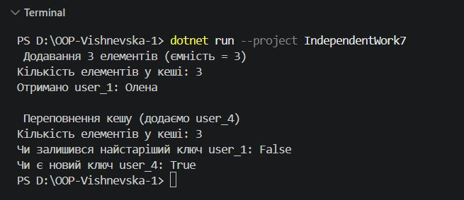

# Самостійна робота №7: Узагальнений кеш `Cache<TKey, TValue>`
**Студентка:** Вишневська Наталія  
**Проєкти:** `IndependentWork7`, `IndependentWork7.Tests`  

---
##  Реалізація
* **`Cache<TKey, TValue>`** — узагальнений кеш з обмеженою ємністю (`_capacity`)
 та політикою витіснення **FIFO**.
* Поєднання **`Dictionary<TKey, TValue>`** (миттєвий пошук/доступ за ключем за $O(1)$) 
та **`Queue<TKey>`** (відстеження порядку додавання ключів: `Enqueue` при додаванні,
 `Dequeue` при переповненні).
* **Юніт-тести (`xUnit`)** — покрито методи `Add`, `Get`, `ContainsKey`, властивість
 `Count`, витіснення найстарішого елемента при переповненні та викидання
  `KeyNotFoundException` для неіснуючого ключа.

### Результат виконання тестів

### Результат запуску програми

---
##  Контрольні запитання
1. **Переваги `Cache<TKey, TValue>` над неузагальненими кешами:** Один код працює
 з будь-якими типами ключів і значень, забезпечує безпеку типів під час компіляції
  та уникає втрат продуктивності на упаковку/розпаковку (Boxing/Unboxing).
2. **Навіщо поєднувати `Dictionary` з `Queue` або `LinkedList`:** `Dictionary` забезпечує
 швидкий пошук за $O(1)$, але не зберігає порядок додавання елементів. `Queue` зберігає
  хронологію і дозволяє за $O(1)$ дізнатися та видалити найстаріший ключ.
3. **Коли `Get` має викидати `KeyNotFoundException`, а коли краще `TryGetValue`:** `Get` із 
винятком доцільний, коли відсутність ключа — це критична або неочікувана помилка в логіці.
 `TryGetValue` (або `TryGet`) краще використовувати у звичайному кешуванні (cache miss),
  коли відсутність запису є штатною ситуацією, щоб не витрачати ресурси на генерацію
   винятків.
4. **Критично важливі тести для політики витіснення:** Перевірка точного дотримання
 `_capacity` після переповнення; перевірка, що видалено саме найперший доданий ключ 
 (`ContainsKey` повертає `false`, `Get` кидає `KeyNotFoundException`); перевірка, 
 що новіші елементи залишилися неушкодженими, а оновлення існуючого ключа
  не викликає хибного витіснення.