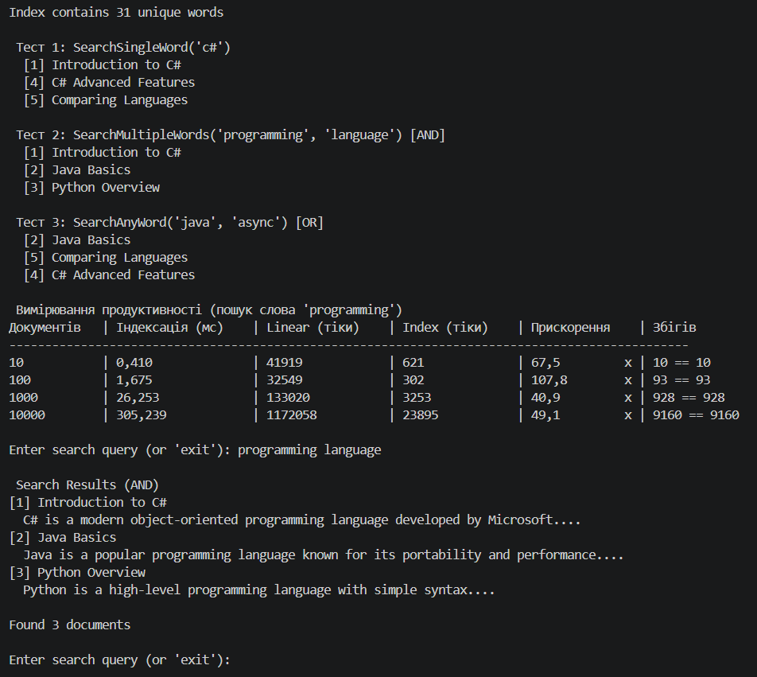

# Самостійна робота №16: Інвертований індекс (`InvertedIndexDemo`)
**Студентка:** Вишневська Наталія 
**Проєкт:** `InvertedIndexDemo`  

### Результат виконання програми

---
##  Відповіді на контрольні запитання
1. **Чому `Dictionary<string, HashSet<int>>` добре підходить для інвертованого індексу:** 
Словник забезпечує доступ до списку документів за словом за константний час $O(1)$, а
 `HashSet<int>` автоматично запобігає дублюванню `Id` документа, навіть якщо слово 
 зустрічається в тексті багато разів.
2. **Переваги `HashSet<T>` для AND/OR-пошуку:** Вбудовані методи `IntersectWith` (перетин
 множин для логічного AND) та `UnionWith` (об'єднання для логічного OR) працюють за 
 хешами елементів зі складністю $O(N)$, що набагато швидше за вкладені цикли по списках
  ($O(N \cdot M)$).
3. **Чому важлива однакова нормалізація тексту:** Якщо індекс прибирає пунктуацію та
 стоп-слова, а лінійний пошук шукає звичайним `Contains` по сирому тексту, підходи 
 повертатимуть різну кількість документів і виконуватимуть різний обсяг роботи, 
 що робить порівняння часу некоректним.
4. **Обмеження простої реалізації інвертованого індексу:**
   * Відсутність **ранжування (TF-IDF / BM25)** — усі знайдені документи повертаються
    без сортування за релевантністю.
   * Відсутність **стемінгу / лематизації** — слова `"program"`, `"programming"` 
   і `"programs"` вважаються різними ключами.
   * Неможливість **пошуку точних фраз** (потрібно додатково зберігати позиції слів у документі — Positional Index).