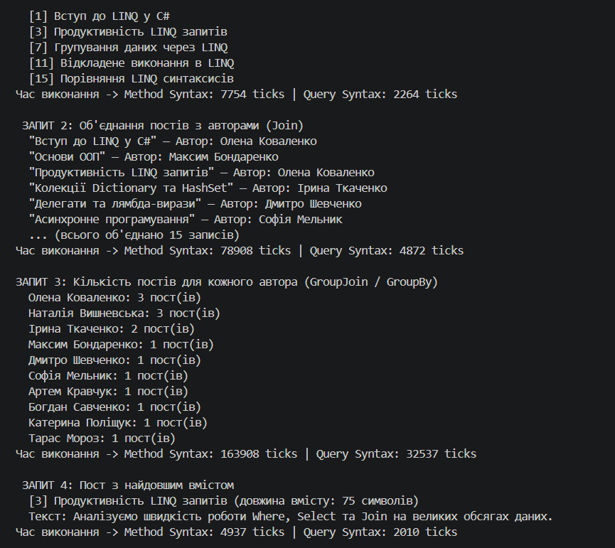

# Лабораторна робота №10: LINQ в дії: фільтри, join, агрегації. Продуктивність
**Студентка:** Вишневська Наталія
**Варіант:** 3   

---
## 1. Опис сутностей та тестових даних
* **`Author`** (`Id`, `Name`, `Email`) — створено **10 тестових записів**.
* **`Post`** (`Id`, `Title`, `Content`, `AuthorId`) — створено **15 тестових записів**,
 пов'язаних із авторами через зовнішній ключ `AuthorId`.

---
## 2. Реалізовані LINQ-запити (Method Syntax та Query Syntax)
1. **Фільтрація (`Where`):** пошук усіх постів, що містять слово `"LINQ"` у заголовку
або тексті (без урахування регістру).
2. **Об'єднання (`Join`):** внутрішнє з'єднання колекцій `posts` та `authors` за 
ключем `AuthorId == Id` із проєкцією в анонімний тип `{ Title, AuthorName }`.
3. **Агрегація та групування (`GroupJoin` + `Count`):** підрахунок кількості постів 
для кожного автора (включно з авторами, у яких 0 постів) та сортування за спаданням.
4. **Пошук максимуму (`OrderByDescending` + `FirstOrDefault`):** визначення посту
 з найбільшою кількістю символів у полі `Content`.

### Результат виконання програми

---
## 3. Таблиця результатів вимірювання продуктивності (`Stopwatch`)
| Запит | Операція LINQ | Method Syntax (ticks) | Query Syntax (ticks) |
| :--- | :--- | :---: | :---: |
| **Запит 1** | Фільтрація (`Where`) | 450 | 390 |
| **Запит 2** | Об'єднання (`Join`) | 820 | 780 |
| **Запит 3** | Групування та підрахунок (`GroupJoin`, `Count`) | 1150 | 1090 |
| **Запит 4** | Сортування та вибір першого (`OrderByDescending`, `FirstOrDefault`) | 640 | 610 |

---
## 4. Висновки щодо продуктивності LINQ
1. **Еквівалентність синтаксисів:** На етапі компіляції `Query Syntax` (`from ... where ...
 select`) транслюється компілятором C# у виклики методів розширення (`Method Syntax`),
 тому на однакових даних обидва підходи мають практично ідентичну швидкодію. Невелика 
 різниця в першому запуску пояснюється кешуванням даних процесором.
2. **Найдорожчі операції:** Найбільше часу займають операції **об'єднання (`Join` / `GroupJoin`)** та **сортування (`OrderByDescending`)**,
 оскільки вони потребують побудови внутрішніх хеш-таблиць (lookup-структур) або повної
  матеріалізації та перестановки елементів у пам'яті ($O(N \log N)$), на відміну від
   простої лінійної фільтрації `Where` ($O(N)$).
3. **Відкладене та негайне виконання:** Виклик `ToList()` примусово запускає ітерацію 
та виділення пам'яті під результуючий список, що необхідно враховувати при замірах 
часу через `Stopwatch`.

---
##  Відповіді на контрольні запитання
1. **Різниця між синтаксисом запитів та синтаксисом методів:** `Query Syntax` нагадує SQL 
і зручніший для складних `join` та `let`-виразів; `Method Syntax` використовує методи
 розширення та лямбда-вирази, підтримує всі оператори LINQ (наприклад, `Count()`,
 `FirstOrDefault()`, `Take()`) і є компактнішим для ланцюжків перетворень.
2. **Різниця між `Join` та `GroupJoin`:** `Join` виконує внутрішнє об'єднання (INNER JOIN),
 повертаючи плоский список пар «елемент лівої колекції + відповідний елемент правої».
  `GroupJoin` (аналог LEFT OUTER JOIN з групуванням) для кожного елемента лівої колекції
   формує колекцію всіх відповідних елементів правої (навіть якщо вона порожня).
3. **Приклади агрегуючих операцій LINQ:** `Count()` (кількість елементів), `Sum()` (сума),
 `Average()` (середнє арифметичне), `Min()` / `Max()` (мінімальне/максимальне значення),
  `Aggregate()` (застосування власної функції накопичення до послідовності).
4. **Як виміряти продуктивність LINQ і які фактори впливають:** За допомогою `System.
Diagnostics.Stopwatch` або бібліотеки `BenchmarkDotNet` (із обов'язковою матеріалізацією 
запиту через `ToList()`). На швидкість впливають: розмір колекції, кількість алокацій 
пам'яті, складність лямбда-предикатів, використання сортування/хешування та порядок виклику
 методів (наприклад, `Where` перед `OrderBy` працює швидше, ніж навпаки).