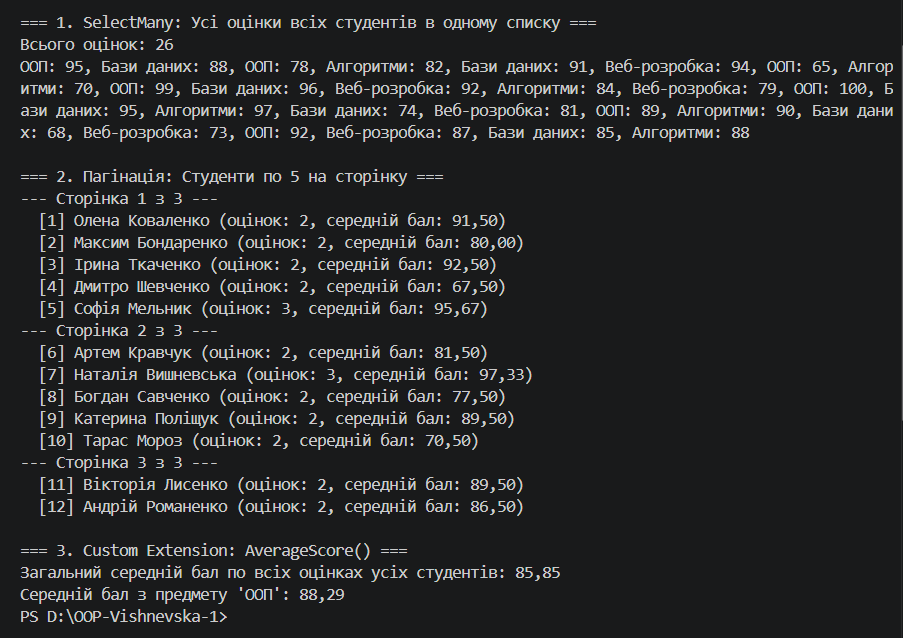

# Лабораторна робота №11: LINQ: SelectMany, пагінація й custom extensions
**Студентка:** Вишневська  
**Варіант:** 3 

---
## 1. Опис сутностей та тестових даних
* **`Subject`** (`Id`, `Name`) — створено **4 навчальні предмети** («ООП», «Бази даних» 
«Алгоритми», «Веб-розробка»).
* **`Grade`** (`Subject`, `Score`) — оцінка студента з конкретного предмета.
* **`Student`** (`Id`, `Name`, `List<Grade> Grades`) — створено **12 студентів**, кожен 
із яких має вкладений список оцінок (`Grades`).

---
## 2. Реалізовані операції LINQ
1. **`SelectMany`:** розгортання вкладених списків `Grades` усіх 12 студентів у 
єдину плоску послідовність `List<Grade>` (26 оцінок).
2. **Пагінація (`Skip` / `Take`):** розбиття списку студентів на сторінки по **5 елементів** 
на сторінку (`Skip((page - 1) * pageSize).Take(pageSize)`), виведено 
всі 3 сторінки поспіль.
3. **Custom Extension (`AverageScore`):** статичний метод розширення `AverageScore(this 
IEnumerable<Grade> grades)`, який перевіряє колекцію на `null` та порожнечу й обчислює
 середній бал. Продемонстровано як для кожного студента окремо, так і для всіх оцінок 
 потоку.

### Результат виконання програми


---
## 3. Відповіді на контрольні запитання
1. **Для чого використовується оператор `SelectMany` і чим відрізняється від `Select`:** 
`Select` перетворює кожен елемент вхідної колекції один-до-одного (наприклад, зі списку
 `List<Student>` поверне `IEnumerable<List<Grade>>` — колекцію колекцій). `SelectMany
 ` проєктує кожен елемент у колекцію і «розгортає» (flattening) усі вкладені колекції
  в одну плоску послідовність `IEnumerable<Grade>`.
2. **Як реалізувати пагінацію даних за допомогою LINQ:** За допомогою комбінації методів
 `Skip((pageNumber - 1) * pageSize)` (пропускає елементи попередніх сторінок) та
  `Take(pageSize)` (бере задану кількість елементів для поточної сторінки).
3. **Концепція методів розширення та їхня інтеграція з LINQ:** Методи розширення — це
 статичні методи у статичному класі, перший параметр яких має модифікатор `this`. 
 Вони дозволяють викликати метод так, ніби він є екземплярним методом типу (наприклад,
  `grades.AverageScore()`). Весь LINQ to Objects побудований саме як набір методів
   розширення для `IEnumerable<T>` у просторі імен `System.Linq`.
4. **Приклад власного методу розширення для `IEnumerable<T>`:**
   ```csharp
   public static double AverageScore(this IEnumerable<Grade> grades)
   {
       var list = grades.ToList();
       return list.Count == 0 ? 0.0 : list.Average(g => g.Score);
   }