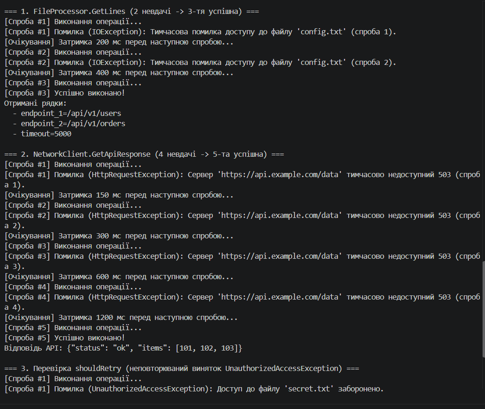

# Лабораторна робота №12: Обробка IO/мережевих помилок та патерн Retry
**Студентка:** Вишневська  
**Варіант:** 3  

---
## 1. Реалізовані класи
* **`FileProcessor`:** метод `GetLines(string path)` імітує `IOException` під час перших 
2 викликів та повертає список рядків на 3-й спробі.
* **`NetworkClient`:** метод `GetApiResponse(string endpoint)` імітує
`HttpRequestException` під час перших 4 викликів та повертає JSON-відповідь 
на 5-й спробі.
* **`RetryHelper`:** узагальнений метод `ExecuteWithRetry<T>` із підтримкою максимальної
 кількості повторів (`retryCount`), експоненційної затримки (`initialDelay`), логування 
 кожної спроби та фільтрації винятків через делегат `shouldRetry`.

### Результат виконання програми

---
## 2. Висновок про принцип роботи експоненційної затримки
У моєму варіанті затримка перед кожною наступною повторною спробою обчислюється за формулою 
$\text{delay} = \text{initialDelay} \times 2^{\text{attempt}-1}$ (наприклад, для мережевого
 запиту з початковою затримкою 150 мс інтервали становлять 150 мс, 300 мс, 600 мс та 1200 
 мс). Це дозволяє уникнути перевантаження віддаленого сервера або файлової системи частими
  запитами під час тимчасового збою та дає ресурсу час на відновлення працездатності.

---
## 3. Відповіді на контрольні запитання
1. **Типові винятки при роботі з файлами та мережею:**
   * Файли та потоки: `IOException`, `FileNotFoundException`, `DirectoryNotFoundException`, `UnauthorizedAccessException`, `PathTooLongException`.
   * Мережа: `HttpRequestException`, `SocketException`, `TimeoutException`, `TaskCanceledException`.
2. **Принцип роботи патерну Retry та коли його доцільно використовувати:** Патерн полягає 
у автоматичному повторному виконанні операції після невдачі із заданою паузою. Його
доцільно застосовувати лише для **тимчасових (transient)** збоїв (короткочасна втрата 
мережі, блокування файлу іншим процесом, код відповіді 503 Service Unavailable), коли
 є висока ймовірність успіху при повторі.
3. **Реалізація експоненційної затримки:** Час очікування множиться на степінь двійки 
залежно від номера невдалої спроби (`initialDelay * Math.Pow(2, attempt - 1)`) і 
передається в `Thread.Sleep` (або `await Task.Delay` в асинхронному коді).
4. **Призначення делегата `shouldRetry`:** Дозволяє розрізняти тимчасові та фатальні 
помилки. Якщо виникає помилка, яку неможливо виправити повтором (наприклад, 
`UnauthorizedAccessException`, `ArgumentNullException` або HTTP 401/404), `shouldRetry` 
повертає `false`, і цикл негайно переривається без марної трати часу.