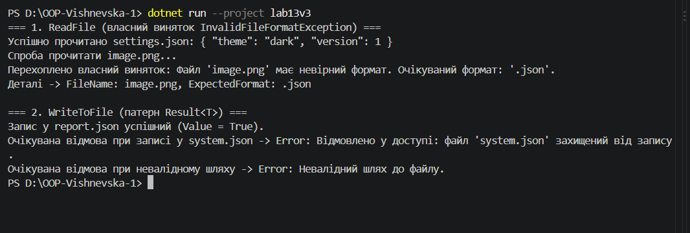

# Лабораторна робота №13: Власні винятки та патерн Result
**Студентка:** Вишневська  
**Варіант:** 3  

---
## 1. Реалізовані компоненти
* **`InvalidFileFormatException`:** власний клас винятку, успадкований від `System.
Exception`, зі стандартними конструкторами та додатковими властивостями `FileName`
 і `ExpectedFormat`.
* **`Result<T>`:** узагальнений клас результату операції з властивостями `IsSuccess`,
 `Value`, `Error`, приватним конструктором та фабричними методами `Success(T)`, `Failure
 (string)` і `Failure(Exception)`.
* **`FileProcessorService`:** сервіс обробки файлів із методом `ReadFile(string path)` 
(викидає `InvalidFileFormatException` при невідповідності розширення `.json`) та методом
 `WriteToFile(string path, string content)` (повертає `Result<bool>` при невалідному шляху
  або відсутності прав запису).

### Результат виконання програми

---
## 2. Висновок про доцільність вибору між винятком та `Result<T>`
* Для методу **`ReadFile`** доцільно використовувати власний виняток 
`InvalidFileFormatException`, оскільки метод зобов'язаний повернути вміст файлу
 (`string`), а передача файлу непідтримуваного формату є винятковою ситуацією, яка
  порушує контракт читання та потребує передачі додаткових метаданих (`FileName`,
   `ExpectedFormat`) на рівень вище.
* Для методу **`WriteToFile`** доцільніше використовувати патерн **`Result<bool>`**,
 оскільки помилки валідації шляху користувачем чи відмова в доступі до захищеного файлу
  є очікуваними робочими сценаріями; повернення `Result<T>` дозволяє обробити їх явно
   без накладних витрат на розгортання стека викликів (`stack unwinding`).

---
## 3. Відповіді на контрольні запитання
1. **Навіщо створювати власні типи винятків і які переваги це дає:** Власні винятки
 дозволяють чітко типізувати предметні помилки бізнес-логіки, перехоплювати їх у окремих
  блоках `catch` (відрізняючи від системних збоїв) та передавати специфічні контекстні
   властивості (наприклад, ім'я файлу чи код помилки).
2. **Які стандартні конструктори рекомендується реалізовувати для власних винятків:**
   * Конструктор без параметрів `MyException()`.
   * Конструктор з повідомленням `MyException(string message)`.
   * Конструктор з повідомленням та внутрішнім винятком `MyException(string message,
    Exception innerException)` для збереження ланцюжка помилок (*exception chaining*).
   * Спеціалізовані конструктори для ініціалізації власних властивостей.
3. **Патерн Result та коли він доцільніший за винятки:** Патерн `Result<T>` інкапсулює результат виконання операції — або успішне значення `Value`, або опис помилки `Error`
 з прапорцем `IsSuccess`. Він доцільніший у сценаріях, де невдача є очікуваним і частим
  результатом (валідація форм, перевірка прав доступу, бізнес-правила), оскільки не 
  створює навантаження на продуктивність від генерації винятків.
4. **Які сценарії обробляти через винятки, а які через `Result<T>`:**
   * **Винятки:** непередбачувані технічні збої, порушення цілісності системи, 
   відсутність критичних ресурсів, помилки мережі чи пошкодження даних, коли подальше 
   виконання методу неможливе.
   * **Патерн `Result<T>`:** очікувані бізнес-помилки та помилки введення користувача 
   (некоректний формат, недостатньо коштів, дублікат запису, заборона запису), які є
    частиною нормального потоку керування програмою.