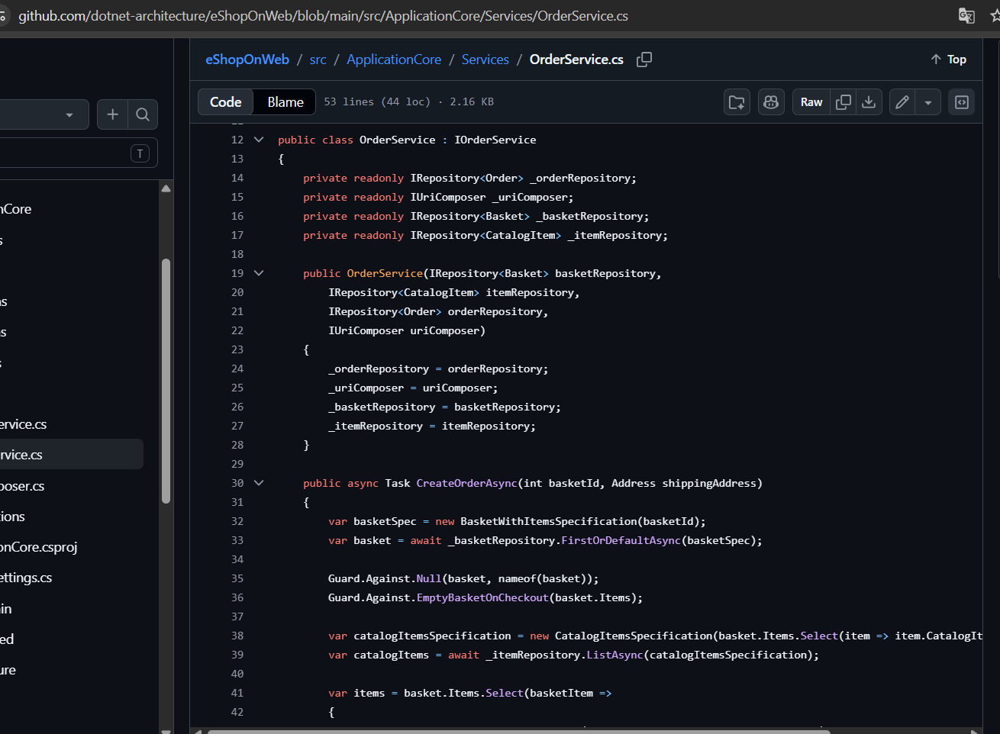

# Лабораторна робота №14: Аналіз SRP/OCP у відкритих репозиторіях
**Студентка:** Вишневська  
**Досліджувані репозиторії:**
1. **Microsoft eShopOnWeb** (E-Commerce / вебзастосунок): `https://github.com/dotnet-architecture/eShopOnWeb`
2. **Serilog** (бібліотека структурованого логування): `https://github.com/serilog/serilog`

---

## 1. Приклади вдалого застосування SRP

### Приклад 1.1: `OrderService` у eShopOnWeb
* **Посилання:** [`src/ApplicationCore/Services/OrderService.cs`](https://github.com/dotnet-architecture/eShopOnWeb/blob/main/src/ApplicationCore/Services/OrderService.cs) (рядки 19–55)
* **Де видно принцип:** Клас `OrderService` відповідає виключно за бізнес-сценарій оформлення замовлення (`CreateOrderAsync`). Він не містить SQL-запитів, не знає деталей роботи з кошиком напряму та не формує HTTP-відповіді — усі ці задачі делеговано інжектованим залежностям (`IRepository<Order>`, `IRepository<Basket>`, `IRepository<CatalogItem>`, `IUriComposer`).
* **Переваги для підтримки:** Клас має лише одну причину для зміни — зміну бізнес-правил створення замовлення. Його легко покрити unit-тестами за допомогою mock-об'єктів.
* **Що зміниться при додаванні нової функції:** При додаванні перевірки промокоду зміниться лише бізнес-ланцюжок координації в `OrderService`, без втручання у шар збереження даних чи формування URL зображень.

### Приклад 1.2: `MessageTemplateParser` у Serilog
* **Посилання:** [`src/Serilog/Parsing/MessageTemplateParser.cs`](https://github.com/serilog/serilog/blob/dev/src/Serilog/Parsing/MessageTemplateParser.cs) (рядки 21–85)
* **Де видно принцип:** Клас займається виключно синтаксичним розбором рядка шаблону повідомлення (наприклад, `"User {UserId} logged in"`) на послідовність токенів (`TextToken` та `PropertyToken`). Він не виконує форматування значень, не фільтрує рівні логування і не записує дані у файл чи консоль.
* **Переваги для підтримки:** Парсер ізольований від форматів виводу (JSON, консоль, файл). Оптимізація швидкості парсингу не зачіпає інші підсистеми бібліотеки.
* **Що зміниться при додаванні нової функції:** Якщо знадобиться підтримати новий модифікатор форматування всередині фігурних дужок `{...}`, зміни торкнуться тільки логіки токенізації в `MessageTemplateParser`.

---

## 2. Приклади порушення SRP

### Приклад 2.1: `OrderController` у вебшарі eShopOnWeb
* **Посилання:** [`src/Web/Controllers/OrderController.cs`](https://github.com/dotnet-architecture/eShopOnWeb/blob/main/src/Web/Controllers/OrderController.cs) (рядки 25–62)
* **Де видно порушення:** Контролер одночасно обробляє HTTP-маршрутизацію, отримує дані через MediatR, перевіряє автентифікацію користувача (`User.Identity.Name`) та вручну виконує мапінг доменних моделей у ViewModel для представлення.
* **Ризики для підтримки:** Поєднання веблогіки, перевірки безпеки та перетворення даних ускладнює повторне використання логіки підготовки даних (наприклад, для мобільного API) та призводить до розростання контролерів.
* **Що зміниться при додаванні нової функції:** Додавання нового поля у відображення історії замовлень змусить редагувати сам контролер, а не окремий мапер чи обробник запиту.

### Приклад 2.2: `LoggerConfiguration` у Serilog
* **Посилання:** [`src/Serilog/LoggerConfiguration.cs`](https://github.com/serilog/serilog/blob/dev/src/Serilog/LoggerConfiguration.cs) (рядки 35–220)
* **Де видно порушення:** Клас поєднує кілька різних відповідальностей: зберігання налаштувань рівня логування (`MinimumLevel`), конфігурування збагачувачів контексту (`Enrich`), керування деструктуризацією об'єктів (`Destructure`) та ініціалізацію фінального екземпляра `Logger` (`CreateLogger`).
* **Ризики для підтримки:** Клас має багато внутрішніх колекцій стану (`_logEventSinks`, `_enrichers`, `_filters`, `_destructurers`) і є точкою входу для майже будь-яких змін конфігурації бібліотеки.
* **Що зміниться при додаванні нової функції:** Будь-який новий механізм глобальної конфігурації логера потребує додавання нових полів та методів безпосередньо в `LoggerConfiguration`.

---

## 3. Приклади розширення за OCP

### Приклад 3.1: Патерн Specification у eShopOnWeb
* **Посилання:** [`src/ApplicationCore/Specifications/CatalogFilterPaginatedSpecification.cs`](https://github.com/dotnet-architecture/eShopOnWeb/blob/main/src/ApplicationCore/Specifications/CatalogFilterPaginatedSpecification.cs) (рядки 8–22) та [`IRepository.cs`](https://github.com/dotnet-architecture/eShopOnWeb/blob/main/src/ApplicationCore/Interfaces/IRepository.cs)
* **Де видно принцип:** Замість того, щоб додавати в репозиторій нові методи (`GetByBrand`, `GetByTypeAndBrand` тощо) при кожному новому фільтрі, репозиторій приймає абстракцію `ISpecification<T>`. Нові умови вибірки створюються як окремі класи-специфікації.
* **Переваги для підтримки:** Клас репозиторію залишається повністю закритим для модифікації, а критерії пошуку інкапсульовані в маленьких класах, які не впливають один на одного.
* **Що зміниться при додаванні нової функції:** Для додавання фільтрації товарів за акційною ціною достатньо створити один новий клас `CatalogOnSaleSpecification`, не змінюючи жодного рядка в репозиторії.

### Приклад 3.2: Інтерфейс приймачів логів `ILogEventSink` у Serilog
* **Посилання:** [`src/Serilog/Core/ILogEventSink.cs`](https://github.com/serilog/serilog/blob/dev/src/Serilog/Core/ILogEventSink.cs) (рядки 18–26) та [`SafeAggregateSink.cs`](https://github.com/serilog/serilog/blob/dev/src/Serilog/Core/Sinks/SafeAggregateSink.cs)
* **Де видно принцип:** Ядро Serilog працює виключно з контрактом `ILogEventSink`, який має єдиний метод `void Emit(LogEvent logEvent)`. Усі місця призначення логів (консоль, файл, Elasticsearch, Seq) підключаються як незалежні плагіни-реалізації цього інтерфейсу.
* **Переваги для підтримки:** Ядро бібліотеки не знає про зовнішні сервіси, бази даних чи файлову систему, завдяки чому залишається стабільним роками.
* **Що зміниться при додаванні нової функції:** Щоб відправляти логи у нове сховище (наприклад, у Kafka), достатньо реалізувати інтерфейс `ILogEventSink` у зовнішньому пакеті без зміни вихідного коду ядра Serilog.

### Скріншот фрагмента аналізованого коду на GitHub


---

## 4. Пропозиція рефакторингу (для `OrderController` у eShopOnWeb)
**Проблема:** У `OrderController` змішано маршрутизацію HTTP-запитів та логіку отримання/трансформації моделей замовлень.

**Рішення:** Винести логіку отримання даних та мапінгу у виділений сервіс читання `IOrderViewModelService`:

```csharp
public interface IOrderViewModelService
{
    Task<IEnumerable<OrderViewModel>> GetUserOrdersAsync(string userName);
    Task<OrderDetailViewModel?> GetOrderDetailsAsync(int orderId, string userName);
}

public class OrderController : Controller
{
    private readonly IOrderViewModelService _orderViewModelService;

    public OrderController(IOrderViewModelService orderViewModelService)
    {
        _orderViewModelService = orderViewModelService;
    }

    [HttpGet]
    public async Task<IActionResult> MyOrders()
    {
        var viewModel = await _orderViewModelService.GetUserOrdersAsync(User.Identity!.Name!);
        return View(viewModel);
    }
}
```
Такий рефакторинг залишає контролеру єдину відповідальність — прийом HTTP-запиту та вибір `IActionResult`, а логіку формування ViewModel робить незалежною та придатною для модульного тестування.

---
## 5. Висновки
Аналіз репозиторіїв **eShopOnWeb** та **Serilog** показує, що дотримання принципів SRP та
 OCP безпосередньо визначає життєздатність проєкту при масштабуванні. Найбільшу 
 архітектурну стійкість забезпечують точки розширення через вузькі інтерфейси
  (`ILogEventSink` у Serilog та `ISpecification<T>` у eShopOnWeb), які дозволяють додавати 
новий функціонал без ризику зламати ядро системи. Водночас навіть у зразкових open-source
 проєктах трапляються компроміси з SRP у точках входу або конфігурації 
(`LoggerConfiguration`, вебконтролери), де зручність API для розробника інколи переважає
над суворою декомпозицією. Усвідомлене розділення відповідальностей критично важливе 
саме в ядрі бізнес-логіки та плагінних підсистемах, де вимоги змінюються найчастіше.

---
##  Відповіді на контрольні запитання
1. **Як відрізнити окрему відповідальність класу від просто великого обсягу коду:**
 Великий клас може мати багато рядків коду, але вирішувати одну зв'язну задачу для однієї
  групи користувачів (наприклад, складний математичний парсер). Натомість порушення SRP
   проявляється тоді, коли в класі є методи, що змінюються з різних причин і стосуються 
   різних доменів (наприклад, бізнес-розрахунки + SQL-запити + форматування виводу).
2. **Які ознаки в коді найкраще підтверджують дотримання OCP:** 
Використання інтерфейсів або абстрактних базових класів як точок підключення плагінів,
 застосування патернів Strategy, Decorator або Specification, відсутність довгих
  конструкцій `switch` / `if-else` за типом сутності та реєстрація реалізацій у 
  DI-контейнері.
3. **Чому для аналізу SRP/OCP важливо дивитися не лише на інтерфейси, а й на місця 
розширення системи:** Наявність інтерфейсу сама по собі не гарантує OCP — якщо при
 додаванні нової реалізації все одно доводиться відкривати фабрику або сервіс і
  дописувати гілку `case` у `switch`, принцип OCP порушено. Реальна перевірка 
  відбувається саме там, де система підключає нові модулі.
4. **Які ризики виникають, якщо застосовувати рефакторинг «під патерн» без реальної 
потреби:** Виникає надмірне ускладнення архітектури (*over-engineering*): з'являються 
десятки зайвих інтерфейсів і класів-обгорток із єдиною реалізацією, код стає важко
 читати та налагоджувати, а час розробки простих функцій зростає без реальної вигоди
  для гнучкості.