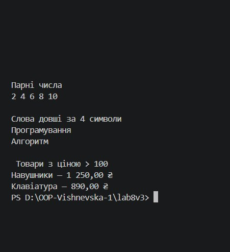

# Лабораторна робота №8: Делегати й лямбда-вирази
**Студентка:** Вишневська  
**Варіант:** 3 (`CollectionHelper<T>.Filter`)  

##  Реалізація
Створено статичний узагальнений клас `CollectionHelper<T>` із власною реалізацією 
методу `Filter(IEnumerable<T> collection, Predicate<T> predicate)` через цикл
 `foreach` (без використання LINQ `.Where()`).

### Приклад роботи у `Main`:
* **`List<int>`**: фільтрація парних чисел (`n => n % 2 == 0`) -> `2 4 6 8 10`
* **`List<string>`**: слова довші за 4 символи (`w => w.Length > 4`) -> `Програмування`, `Алгоритм`
* **`List<Product>`**: товари з ціною > 100 (`p => p.Price > 100m`) -> `Навушники`, `Клавіатура`
---
##  Відповіді на контрольні запитання

1. **Що таке делегат і для чого він використовується?**  
   Делегат — це безпечний до типів вказівник (посилання) на метод із конкретною сигнатурою. Він дозволяє передавати методи як параметри в інші методи та реалізовувати зворотні виклики (callbacks).

2. **У чому полягає різниця між `Func` та `Action`?**  
   `Func<..., TResult>` завжди повертає значення (останній параметр типу вказує тип результату), тоді як `Action<...>` використовується для методів, які нічого не повертають (`void`). (Також у роботі використано `Predicate<T>` — це спеціалізований делегат, який приймає `T` і завжди повертає `bool`).

3. **Як лямбда-вирази спрощують роботу з делегатами?**  
   Лямбда-вирази (`x => x > 5`) дозволяють записати анонімну функцію прямо в місці виклику методу в один рядок, без необхідності створювати окремий іменований метод у класі.

4. **Які переваги дають узагальнені методи при роботі з колекціями?**  
   Вони дозволяють написати алгоритм обробки (наприклад, фільтрацію) один раз і 
   використовувати його для будь-яких типів колекцій (`int`, `string`, `Product`) зі
    збереженням суворої перевірки типів під час компіляції та без втрат на Boxing/Unboxing.
   
