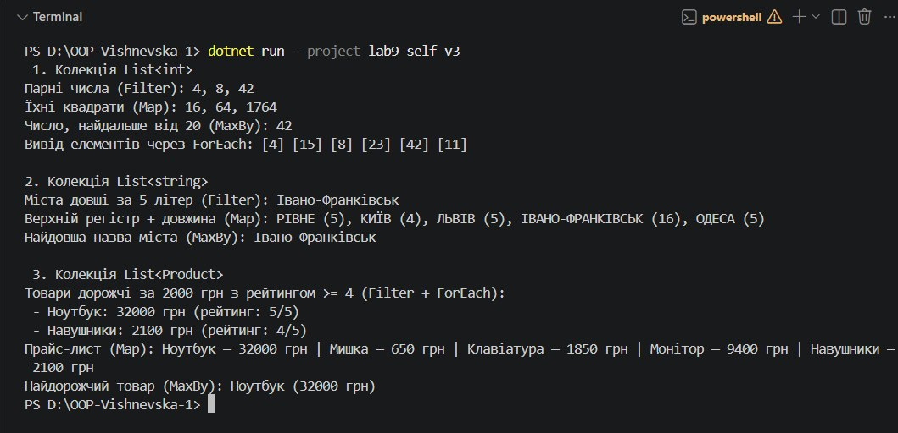

# Самостійна робота №15: Делегати й лямбда-вирази: власні утиліти для колекцій
**Студентка:** Вишневська Наталія 
**Варіант:** 3 (`lab9-self-v3`)  

---
##  Реалізовані методи `CollectionUtils`
* **`Map<TSource, TResult>`** (`Func<TSource, TResult>`) — проєкція кожного
елемента колекції у новий тип або формат.
* **`MaxBy<T, TKey>`** (`Func<T, TKey> where TKey : IComparable<TKey>`) — пошук е
лемента з максимальним значенням обраного ключа.
* **`Filter<T>`** (`Predicate<T>`) — фільтрація елементів за логічною умовою.
* **`ForEach<T>`** (`Action<T>`) — виконання побічної дії (наприклад, виводу в консоль) 
для кожного елемента.

### Результат виконання програми

---
## Відповіді на питання

### 1. Чому делегати корисні для створення таких утиліт?
Делегати дозволяють відокремити **алгоритм обходу колекції** (цикл `foreach`, перевірку на 
`null`, збирання результату) від **конкретної бізнес-логіки** (умови фільтрації, правила 
перетворення чи вибору ключа). Завдяки цьому один узагальнений метод `Filter` або `Map`
 можна повторно використовувати для будь-яких типів даних і будь-яких умов без дублювання
  коду.
### 2. Як лямбда-вирази спрощують виклик цих методів?
Без лямбда-виразів для кожної простої перевірки або перетворення довелося б оголошувати
 окремий іменований метод у класі (наприклад, `bool IsExpensive(Product p)`). Лямбда-вирази
  (`p => p.Price > 2000`) дозволяють передавати логіку компактно прямо в місці виклику,
   автоматично виводять типи параметрів із контексту та роблять код декларативним і легким
 для читання.
### 3. Порівняння власних методів із вбудованими LINQ-операторами
| Власний метод | Аналог у LINQ | Головна відмінність у виконанні |
| :--- | :--- | :--- |
| `CollectionUtils.Map` | `Enumerable.Select` | Наш метод використовує **негайне виконання (Eager Execution)** — одразу створює `List<TResult>` у пам'яті. `Select` використовує **відкладене виконання (Deferred Execution)** через `yield return`. |
| `CollectionUtils.Filter` | `Enumerable.Where` | Аналогічно: наш `Filter` повертає готовий `List<T>` і приймає `Predicate<T>`, тоді як `Where` повертає ледачий ітератор і приймає `Func<T, bool>`. |
| `CollectionUtils.MaxBy` | `Enumerable.MaxBy` (з .NET 6) | Вбудований `MaxBy` додатково підтримує кастомний `IComparer<TKey>` і оптимізований для різних колекцій. |
| `CollectionUtils.ForEach` | `List<T>.ForEach` (у LINQ відсутній) | У класичному LINQ немає `ForEach` для `IEnumerable<T>`, оскільки LINQ дотримується функціонального стилю без побічних ефектів; цей метод є лише у `List<T>`. |

---
##  Відповіді на контрольні запитання
1. **Чому делегати зручні для передавання поведінки:** Вони інкапсулюють посилання на 
метод як об'єкт (типобезпечний callback), дозволяючи передавати поведінку як звичайний
 параметр у метод.
2. **Різниця між `Func<T, TResult>`, `Action<T>` та `Predicate<T>`:**
   * `Func<T, TResult>` приймає аргумент(и) і повертає значення типу `TResult`.
   * `Action<T>` приймає аргумент(и), виконує дію і нічого не повертає (`void`).
   * `Predicate<T>` приймає один аргумент типу `T` і завжди повертає `bool` (аналог
    `Func<T, bool>`).
3. **Переваги поєднання generic-методів і лямбда-виразів:** Повна безпека типів на етапі
 компіляції без приведення типів (`object`), відсутність дублювання коду для різних 
 класів та висока читабельність виразів.
4. **Коли власні утиліти корисні попри наявність LINQ:** Коли потрібна специфічна
 бізнес-логіка обробки (наприклад, логування кожного кроку, особлива обробка винятків),
  гарантоване негайне виконання без ризику повторної ітерації ледачого `IEnumerable`,
   або в середовищах/мікрофреймворках з обмеженнями на алокації пам'яті.