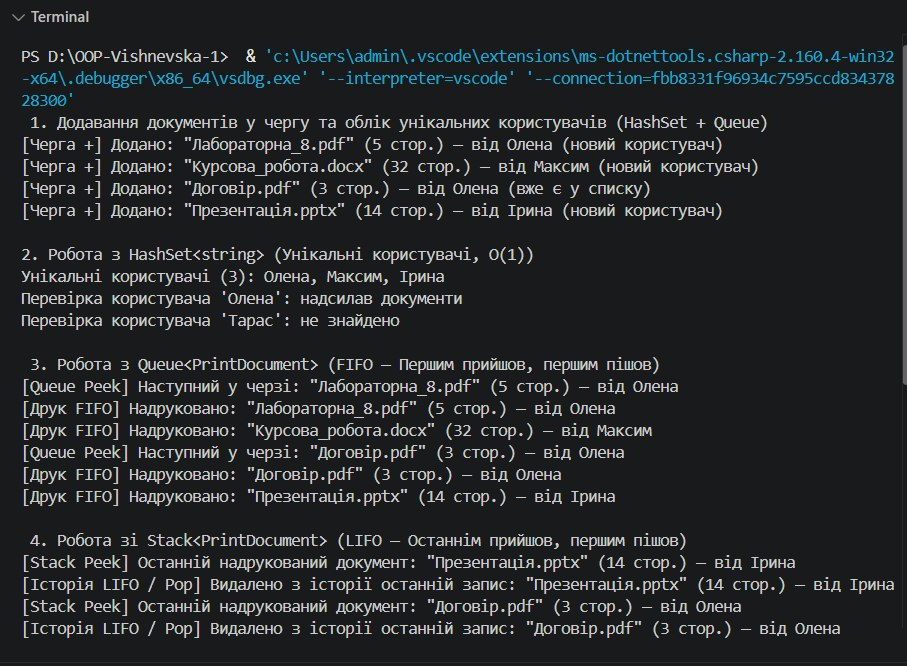

# Лабораторна робота №9
**Студентка:** Вишневська Наталія 
**Варіант:** 3  

---
##  Реалізація підзадач
* **`HashSet<string>`** — зберігання унікальних користувачів, які надсилали документи на друк (`Add`, `Contains`). Дублікати імен ігноруються автоматично за час $O(1)$.
* **`Queue<PrintDocument>`** — черга документів на друк за принципом **FIFO** (`Enqueue`, `Peek`, `Dequeue`): документи друкуються строго в тому порядку, в якому надійшли.
* **`Stack<PrintDocument>`** — історія надрукованих документів за принципом **LIFO** (`Push`, `Peek`, `Pop`): дозволяє переглянути або скасувати з історії останній надрукований документ.

### Скріншот консольного виводу програми

---

##  Контрольні запитання
1. **Різниця між `List<T>` та `HashSet<T>`:** `List<T>` зберігає елементи в певному
 порядку, допускає дублікати і шукає за $O(n)$. `HashSet<T>` зберігає лише унікальні
елементи без гарантії порядку і виконує пошук/додавання за $O(1)$.
2. **Коли використовувати `Queue<T>` замість `List<T>`:** Коли потрібна сувора обробка
 елементів по черзі (FIFO) — видалення з початку черги у `Queue<T>` працює за $O(1)$,
  тоді як у `List<T>` (`RemoveAt(0)`) це займає $O(n)$ через зсув усіх елементів.
3. **Приклад задачі для `Stack<T>`:** Кнопка «Скасувати дію» (Undo) у текстовому редакторі,
 кнопка «Назад» у браузері або перевірка правильності дужок у виразі.
4. **Складність `Contains()` у `HashSet<T>`:** $O(1)$ у середньому випадку, оскільки
 елемент знаходиться напряму за його хеш-кодом у внутрішній хеш-таблиці без перебору
 всієї колекції.
5. **Чому FIFO та LIFO:** `Queue` — **First-In, First-Out** (перший прийшов — перший 
оброблений, як звичайна черга). `Stack` — **Last-In, First-Out** (останній прийшов —
 перший вийшов).